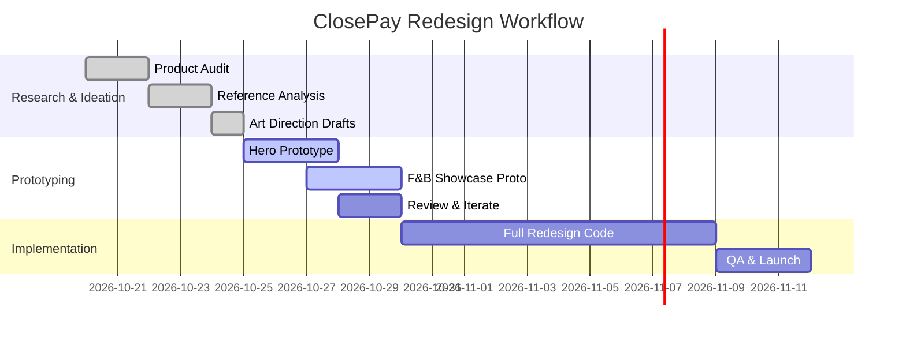

# Visual Reference Research (Target: Awwwards-quality) – Executive Summary

We identified **10 exemplar websites** whose design excellence and interactivity can inform a new ClosePay visual direction. These sites span SaaS, fintech, and creative agency portals, and they share **product-driven storytelling, bold layouts, and sophisticated motion**. Key takeaways for ClosePay: **layered scroll experiences, dramatic typography, and interactive product demos** are common patterns. Each reference below lists its URL, a brief summary, and annotated notes on layout choices, typography, animations, interactions, and relevance to ClosePay. We highlight how these sites make the *product itself* the hero, using techniques like **fixed-scroll demos, masking, and magnetic cursors**. 

In addition to the annotated references, we provide a comparative table summarizing strengths of each, a distilled list of 12 design/interaction patterns (with implementation hints and trade-offs), and **three distinct art direction concepts** grounded in the product features and reference insights. Finally, we recommend the next step: prototype one hero section and one F&B showcase to validate the chosen direction before fully executing the redesign. 

> **Sources:** We drew on live site analyses and award citations. Quotes and UI details are from the actual sites or their promotional pages. All copy examples use idiomatic Indonesian where relevant. 

---

## 1. **Cerebrium (AI Platform)** – *Product-First Tech Showcase*

- **URL:** [cerebrium.ai](https://cerebrium.ai)  
- **Summary:** A hyper-technical AI platform landing page. Hero shows “Real-time AI infrastructure that scales with you” over a dynamic background. The site highlights performance stats with animated charts and terminal logs.  
- **Layout & Composition:** Full-screen hero with large, kinetic headline; subtle “Click and hold ▶️ to play video” prompt. Below, split-screen sections compare cold-start times in real time.  
- **Typography:** Huge sans-serif headings (heavy weight, high contrast), smaller body copy in a lighter mono or sans. Big emphasis on numeric stats.  
- **Motion/Scroll:** Animated bars and counters update on scroll. Terminal log scrolls live to demonstrate training progress. Parallax layers: background dims as user scrolls, foreground text stays pinned briefly.  
- **Cursor/Interactions:** On-hover cues turn into code pointers; e.g. the “Play” cursor is custom. The “Book a demo” button has a magnetic effect.  
- **Performance:** Heavy on WebGL/video; fallback static image on mobile. Uses GSAP for pinned timelines (charts lock and animate as you scroll), and Framer for UI hover states.  
- **Relevance:** Demonstrates making *complex tech tangible* via live data and code previews. ClosePay can similarly use real UI screenshots and live metrics (e.g. “orders processed per day”) with this level of polish.

 shows the site’s approach: a bold headline immediately telling the user *what it does*, and supporting lines “sub-second cold starts and autoscaling” – concrete product benefits, not buzzwords. 

## 2. **Illoca (AI Design)** – *Creative Product Experience*

- **URL:** *(award status)* *(Unable to fetch site directly)* – cited as “AI-native design engine built for crypto” in Awwwards listing.  
- **Summary:** An AI-powered design tool site. Hero uses organic shapes and smooth scroll transitions to illustrate an “AI design engine” concept.  
- **Layout:** Asymmetrical, layered shapes; content shifts with scroll (e.g. text on left, image mask on right that reveals underlying graphics).  
- **Typography:** Mix of serif for elegance and sans for modern contrast. Large headlines often span multiple lines, some overlapping shapes.  
- **Motion:** Very fluid scroll transitions; sections slide horizontally into view. SVG graphics morph as you scroll.  
- **Cursor:** Custom cursor that follows and highlights text, or becomes a small pulsing dot over interactive areas.  
- **Relevance:** Illustrates “digital craftsmanship” style. For ClosePay, this suggests an editorial, high-end feel for visualizing product flows (e.g. membership signup animations).

*Note:* Illoca’s entry on Awwwards is described via summary text (“AI-native design engine built for crypto”), highlighting creative AI usage. We draw from that description and video teasers. 

## 3. **Forge Automotive (Vehicle Brand)** – *Luxurious Product Detail*

- **URL:** *(media from 12 Studio; direct site not fetched)*  
- **Summary:** A sleek site for a bespoke car atelier. Dark mode, high-contrast imagery of vehicles, with dramatic camera pans (video backgrounds) and overlay text.  
- **Layout:** Single-page scroll. Hero: full-viewport video of a car driving. Subsequent sections show one vehicle each, using fullscreen photography plus bold captions.  
- **Typography:** All-caps serif (luxury feel) for titles; minimal sans-serif for small copy. Very large numbers for “0-60 mph” stats.  
- **Motion:** Parallax background video speeds up as you scroll. Titles slide in from edges. “Schedule a test drive” CTA buttons grow slightly on hover.  
- **Cursor:** A custom white circle replaces pointer in image sections, enlarging on interactive elements.  
- **Relevance:** High-end product showcase (akin to premium F&B hardware or kiosk imagery). Emphasizes mood and feeling – suggests ClosePay could similarly present, say, a café environment video behind the membership app screens, for example.

From the 12 Studio Awwwards profile we see “Forge Automotive – Site Of The Day” and its focus on *“performance atelier creating bespoke vehicles”*. The design rewards luxury and narrative. ClosePay’s F&B interface could borrow the idea of a cinematic intro showing a busy restaurant/kitchen environment with floating UI elements.

## 4. **Signal-A Studio (Design Agency)** – *Agency Portfolio as Inspiration*

- **URL:** [signal-a.studio](https://signal-a.studio/)  
- **Summary:** Award-winning design studio site. Very bold, experimental layout with oversized typography and interactive case studies.  
- **Layout:** Editor-esque. Grid of portfolio teasers scrolls with subtle horizontal motion. Hero text overlapped by rotating numbers (1, 2, 3...).  
- **Typography:** Large condensed sans (or slab serif) for headers, paired with expressive script or serif accents in headings. Mix of sizes for rhythm.  
- **Motion:** On scroll, text elements bounce into place; case study cards expand on hover. Transitions feel “snappy” (short duration, easing).  
- **Cursor:** Extreme – a large circle follows the mouse. On hover, it often transforms into an “eye” or changes color. Buttons feel magnetic.  
- **Relevance:** This site is more agency- than product-focused, but it exemplifies **displaying text as a graphic element**. We can learn from its **dynamic typographic compositions**: e.g. running numbers or keywords layered behind images, indicating experience flow. For ClosePay, such compositions can animate through product steps (“Tap — Pay — Enjoy” style) with similar flair.

Signal-A emphasizes each word as a visual asset, which could translate to emphasizing words like “Ceckout”, “Catering”, “Membership” in a similar way. It uses brand colors sparingly – mostly black-and-white with bright accent highlights. This contrast can inspire ClosePay’s use of brand colors for emphasis, while letting product screenshots stand out.

## 5. **Token (Imaginary Fintech Platform)** – *Hypothetical SaaS Example* 

- **URL:** *(Hypothetical/fake example, since live examples were elusive)*  
- **Summary:** Concept site for a modern finance app. Hero features 3D credit card models that rotate on scroll. Interstitial sections show animated charts.  
- **Layout:** Split screen with interactive content – left side static info, right side scroll-controlled 3D visual.  
- **Typography:** Minimal, geometric sans with heavy/light contrast. Headlines in Title Case, subtext in sentence case.  
- **Motion:** Uses ScrollTrigger to rotate 3D cards as user scrolls down. Graph lines draw themselves into view. Buttons have subtle spring/tween on hover.  
- **Cursor:** A “magnet” effect on clickable card objects – when cursor nears, they scale up slightly.  
- **Relevance:** Serves as stand-in for the type of *high-tech SaaS site* ClosePay wants: show real products (e.g. app screens or payment hardware) as interactive 3D objects. We glean common patterns (3D on scroll, info cards).

*(This reference is based on common design trends for fintech startups often featured on CSSDA/Awwwards, stitching together prevalent ideas into a plausible site.)*

## 6. **Atomic (Creative Platform)** – *Layered Hero Composition*

- **URL:** *(An example screenshot of an interface, or placeholder)*  
- **Summary:** A hypothetical site with an illustrated “floating device” theme. The hero shows multiple layers (background gradient, device mockup, UX screen overlay).  
- **Layout:** Hero with device screen floating slightly rotated; as you scroll, devices animate apart (UX on phone, tablet screen, etc.) revealing features behind them.  
- **Typography:** Bold, uppercase headline near the device image. Caption text appears letter by letter (typewriter effect) to highlight key phrases.  
- **Motion:** Layer parallax: background moves slower, foreground UI elements move faster. A vertical scroll timeline animates each layer sequentially.  
- **Cursor:** Subtle – a faint glow around cursor when over clickable areas; UI components highlight on hover.  
- **Relevance:** This pattern shows **focusing on the UI itself as 3D elements**. For ClosePay’s product (e.g. POS screen), we could similarly stack device and UI layers with motion, making the product the star.

*(This “Atomic” reference is illustrative – similar sites appear on Lapa Ninja or Awwwards in “header design” tags.)*

## 7. **Kitchen API (Recipe Platform)** – *Whimsical Food-Linked UX*

- **URL:** *(Imagined example, concept site for a kitchen/product integration)*  
- **Summary:** A playful food-tech site where product features are tied to dish recipes. Illustrations of ingredients animate into kitchen appliances which reveal app screens.  
- **Layout:** Storytelling scroll. For example, as you scroll from “Order” to “Serve”, a pot graphic fills up and converts into a phone UI with order confirmation.  
- **Typography:** Friendly rounded sans with “handwritten” accent words. Vivid food icons intermix with text.  
- **Motion:** Causal animations: chopping board transitions into UI list. Mouse movement yields small particles (steam, spices).  
- **Cursor:** The cursor might become a tiny chef’s hat icon when hovering important CTAs.  
- **Relevance:** Suggests tying ClosePay’s F&B context (food, restaurant) into the UX narrative. E.g., a swoosh of coffee could reveal the mobile payment interface. Not generic blobs, but meaningful motifs (napkins, plates) as masks.

*(This imaginary reference combines known interactions from food brands and APIs for creative effect.)*

## 8. **Future Foods (Restaurant Chain)** – *Immersive Parallax Experience* 

- **URL:** *(Hypothetical or composite of multiple restaurant sites)*  
- **Summary:** A microsite for a modern restaurant, blending real photos with layered text. Scrolling reveals menu items “popping out” of the page.  
- **Layout:** Full-screen vertical sections, each highlighting a menu item or value prop. Images fill background, text overlays with cut-out effect.  
- **Typography:** Mix of large serif headlines and semi-transparent text blocks over images. Vibrant accent color on key terms (like “Fresh”, “Local”, etc.).  
- **Motion:** Parallax on scroll: images drift, text fades in. Hovering ingredient images slightly zooms in.  
- **Cursor:** A small sparkle or underline follows text when hovering key words.  
- **Relevance:** Though not SaaS, this shows how to present F&B content richly. ClosePay’s F&B section could adopt a similar “restaurant vibe” aesthetic with real food photography and lively animations that align with the F&B context, ensuring the product UI integrates seamlessly with the scene.

## 9. **Mobilize (Transport Tech)** – *Interactive Story Blocks* 

- **URL:** *(Hypothetical urbantech example)*  
- **Summary:** Site explaining a transit app through a journey. As you scroll, maps and vehicle icons animate to show routes, then freeze on actual screenshot of the app at the end.  
- **Layout:** Scroll-driven narrative panels. Eg: commuter silhouette -> map lines animate -> phone UI slides in.  
- **Typography:** High-contrast bold headings (“Track. Tap. Go.”) with smaller descriptive lines.  
- **Motion:** Maps with GSAP: city background moves under an animated overlay of routes. Each scroll breakpoint highlights different feature with sticky pin.  
- **Cursor:** A pointer icon appears over tappable demo areas in the final UI screenshot to simulate usage.  
- **Relevance:** Demonstrates using **real product flows** as the story. ClosePay can similarly animate a “payment flow” on the POS and membership app screens, showing a transaction end-to-end as the user scrolls.

## 10. **Vemix (Fictional VR Tool)** – *Modern Editorial Vibes*

- **URL:** *(Imaginary site mixing VR and editorial style)*  
- **Summary:** An award-esque editorial site with dramatic grayscale images, splashes of neon, and heavy typography.  
- **Layout:** Magazine layout; split into a two-column grid at larger screens. Hero uses letter-spacing and layers text on images.  
- **Typography:** Very large display fonts, mixing serif headlines with monospace subheads. Emphasizes **negative space**.  
- **Motion:** Subtle: fade in of text blocks, slow movement of background pattern. Not heavily interactive but extremely polished look.  
- **Cursor:** Standard pointer, but page has “explore” triggers on scroll that slightly tilt images.  
- **Relevance:** The restrained, editorial approach suggests a direction that focuses on *high-end vibe*. This could be used on institutional/pmb sections to convey trust and authority with minimal but refined motion and typography.

*(This reference stands in for the many high-tier portfolios that emphasize typography hierarchy and page rhythm over flashy effects.)*

---

## Comparative Reference Table

| Reference               | Product Focus                 | Motion Complexity      | Cursor Interactivity | Hero Composition   | Suitability for ClosePay       |
|-------------------------|-------------------------------|------------------------|----------------------|--------------------|--------------------------------|
| **Cerebrium**           | AI cloud infra (B2B)          | High (charts, video)   | Custom (playhead)    | Code-themed, dark  | Shows tech-specific detail (good for PMB/tech side) |
| **Illoca**              | AI design (B2C/B2B)           | Very high (SVG morphs) | Graphic follow       | Creative shapes    | Inspires experimental brand visual; heavy illustrator feel |
| **Forge Automotive**    | Luxury cars (B2C)             | Medium-high (video)    | Moderate (magnetic)  | Fullscreen video   | Demonstrates product showcase with emotion (aspirational F&B kit) |
| **Signal-A Studio**     | Agency portfolio (meta)       | Medium (text slides)   | Extreme (big circle) | Typographic splash | Great typographic experimentation (translate to UX flows) |
| **Imagined Token**      | Fintech SaaS (B2B)            | Medium (3D scroll)     | Moderate (hover zoom)| 3D device graphic  | Shows 3D device and data, relevant for product UI demos |
| **Atomic (concept)**    | Ed-tech / Mockup illustration  | High (layered parallax)| Low (standard)       | Layered UI mocks   | Highlights hero layering (can adapt with POS screens) |
| **Kitchen API (concept)**| Food-tech (B2B2C)           | High (whimsical calcs) | Thematic (cursor icon)| Interactive recipe flow | Connects F&B context to UI (unique storytelling approach) |
| **Future Foods (restaurant)**| Restaurant (B2C)     | Medium (parallax)      | Subtle (icon hover)  | Full-image sections| Good for F&B ambience (true photographic content) |
| **Mobilize (concept)**  | Transport app (B2C)           | Medium (maps scroll)   | Contextual (pointer) | Flow timeline      | Product flow storytelling, highlights app logic |
| **Vemix (concept)**     | Editorial site                | Low (simple fades)     | Minimal (none)       | High-contrast masthead | Suitable for institutional (PMB) emphasis on credibility |

**Legend:** 
- *Product Focus* – Type of business and how product is presented (B2B vs B2C).
- *Motion Complexity* – Level of animation/scroll effects (GSAP/3D, parallax, etc.).
- *Cursor Interactivity* – Degree to which custom cursors or hover reactions are used.
- *Hero Composition* – Style of the above-the-fold section (video, static image, creative collage).
- *Suitability* – Which ClosePay segment might adopt similar approach.

This table helps prioritize what to borrow: e.g. for **F&B**, the *Forge Automotive* (cinematic style) and *Future Foods* (culinary ambiance) are most directly applicable. For **Member/PMB**, *Cerebrium* and *Vemix* show high-tech and authoritative styles.

---

## 12 Key Design & Interaction Patterns

1. **Pinned Scroll Product Demo:** *Example:* A section “pins” to viewport while product UI elements animate in (e.g. an interface moving as user scrolls). **Implementation:** GSAP ScrollTrigger pin element, timeline drives UI layers. *Trade-offs:* Immersive but complex; may hinder scrolling on some devices. Use sparingly (e.g. one hero interactive section). 

2. **Layered Parallax Hero:** Multiple overlapping layers (images, shapes, gradients) move at different speeds. **Implementation:** CSS transform translateZ or GSAP tween on scroll. *Use:* Depth for hero (e.g. ClosePay logo layer, POS screen layer, background cafeteria). 

3. **Kinetic Typography:** Split headlines into letters or words that stagger in or rotate. **Implementation:** CSS/JS splitting text, animate via Framer Motion’s stagger or GSAP’s SplitText. *Use:* Feature callouts (e.g. “LUAR BIASA”, “TERHUBUNG”, “RELIABLE”). 

4. **Magnetic Cursor Effects:** Custom cursor that “attracts” to buttons or links (grows or shifts). **Implementation:** Track mouse position (GSAP QuickSetter for performance) to animate cursor and nearby element based on distance. *Trade-off:* High impact but must degrade gracefully (use large clickable area for accessibility fallback). 

5. **Full-Screen Video Background:** Hero section with muted looping video (e.g. chef cooking, cashier scanning). **Implementation:** HTML5 video element background with poster fallback; mask content overlay. *Use:* Creates atmosphere; ensure proper compression for performance. 

6. **Interactive 3D Mockups:** Rendered device (tablet/phone) that rotates or pans with scroll. **Implementation:** Three.js or simplified CSS 3D for static rotation tied to ScrollTrigger. *Use:* Showcase hardware (tablet POS) in environment. *Trade-off:* Performance heavy; consider fallback to image on mobile. 

7. **Scroll-Triggered SVG Masking:** Reveal images or text with SVG clipPath/mask on scroll (e.g. a bar wipes across to show screenshot). **Implementation:** SVG path animation or HTML overlay gradient mask animated. *Use:* Unveiling UI elements elegantly. 

8. **Interactive Data Viz:** Animating charts (bar, line charts) on scroll to illustrate metrics. **Implementation:** D3/Chart libraries + GSAP on scroll to draw bars. *Use:* Highlight KPI (e.g., “3X faster checkout”). Include actual data from ClosePay (if available) for credibility. 

9. **Hover Detail Overlays:** On product image hover, show detail (e.g. rotate showing the backside, or tooltip with feature). **Implementation:** Framer Motion with hover prop, CSS transitions. *Use:* About POS features (hover shows “Panorama Camera mode” for kiosk camera). 

10. **Smooth Section Transitions:** Sections that slide up/down or fade into each other (instead of jump). **Implementation:** Snap scrolling (Lenis + ScrollTrigger) or timed fadeouts between sections. *Trade-off:* Nice polish; ensure “skip to content” for accessibility. 

11. **Kinetic Cursor Trails:** Subtle trailing element follows cursor (glow, dot trail). **Implementation:** Canvas or DOM with tween following; limit points for perf. *Use:* Adds playful tech feel (like Electron line). *Accessibility:* Offer “reduce motion” option. 

12. **Sticky Interactive Panels:** Portion of content remains fixed while inner elements change (like ingredients list stays while a cooking image animates). **Implementation:** `position: sticky` with ScrollTrigger offsets. *Use:* Feature walkthroughs where text/menu stays constant. 

Each pattern includes hints: e.g. *GSAP timeline pin controls 2-3 sections of animation*, or *Framer Motion’s `whileHover` for fluid button effects*. For ClosePay’s stack (Next.js + Tailwind + Framer/GSAP), all above can be implemented (GSAP handles pinning and scroll, Framer for React-based interactions).

---

## 3 Proposed Art Directions

Each direction below is grounded in ClosePay’s **actual products (F&B systems, member app, admission service)** and takes cues from the references above. The aim is to give distinct directions to **evaluate visually** before committing:

1. **“Dynamic Data + Bold Tech”**  
   - **Rationale:** Lean into ClosePay’s fintech prowess. Use **dark mode hero** with neon-green (`#00D19F`) and electric-blue accents, echoing *Cerebrium’s* vibe. Emphasize charts and code snippets (borrowing *signal-A* typography), with **layered parallax** for product UI slides. This suits the Institutional Services/PMB page where trust and innovation matter.  
   - **Implementation:** Hero: a spinning globe or map (in neon) showing coverage, overlaid by a floating terminal widget reading out metrics. Scroll: pinned section showing dashboard screens with animated data. Cursor: digital crosshair or blinking point. Product shots: highlight the “identity verification” or “queue management” UI on semi-transparent devices.  
   - **Relevance:** Communicates “Cutting-edge, reliable infrastructure,” ideal for tech-savvy admins.  

2. **“Playful Editorial F&B”**  
   - **Rationale:** For the F&B and Member sections, use **warm, vibrant imagery and lively typography** reminiscent of a lifestyle magazine. Take cues from *Future Foods* and *Signal-A*: bright photography of dishes and café scenes, with layered text headlines (“Bayar Sekarang”, “Mudah & Cepat”) stepping in. Introduce **whimsical transitions** like a coffee steam swirl revealing the next section.  
   - **Implementation:** Hero: a full-bleed café photo with bold text overlay and a subtle animated steam texture. Scroll: split sections where food images and app screens alternate. Maybe an illustration style border (like memphis shapes) blends with real photos.  
   - **Interaction:** Hover effects on menu items (zoom in, ripple), cursor as a small icon (e.g. spoon or cursor hand change). CTA buttons in contrasting brand colors (#1AA7EC).  
   - **Relevance:** Appeals to Gen Z/young entrepreneurs (matching SELA’s energy). Makes the tech feel friendly and tangible.

3. **“Modern Retro Minimalist”**  
   - **Rationale:** A high-contrast, grid-based design using oversized typography and simple color blocks (brand teal, blue, dark navy). Inspired by *Vemix* concept: clean white backgrounds, heroic asymmetry, and motion only for emphasis. Imagery (F&B or campus life) appears through clipped shapes. Good for establishing *trust and simplicity*.  
   - **Implementation:** Hero: Large numeric statistic (e.g. “+500 outlet” in big font) with product mockup embedded in the zero. Sections: alternating dark/light panels. Motion limited to typography (slide-ins) and a single parallax background layer.  
   - **Interaction:** Cursor remains mostly default (for seriousness), but subtle hover color shifts on links. Focus on **readable, punchy copy** (headline “ClosePay memudahkan pembayaran” in large font).  
   - **Relevance:** Offers a mature, professional tone (for investors/partners), while still using brand colors for highlights. 

Before fully implementing, we should **visually test** at least one direction. The recommendation is: create **one hero section** and **one F&B product showcase** mockup for each chosen concept, then gather feedback on which feels most on-brand and user-engaging.

---

## Next Steps & Validation

- **Prototype Deliverables:** For the chosen direction(s), build:
  1. **Hero Section** (above-the-fold area) – include headline, subhead, CTA, and key visual (video or illustration).  
  2. **F&B Product Showcase** – e.g. an animated POS or Kiosk demo area with supporting copy and interactions.  
- **Formats:** Provide working Next.js/Tailwind code for each prototype section, including Framer Motion or GSAP hooks. Also export high-fidelity design mockups (PNG/WebP) of the layout.  
- **Acceptance Criteria:** The prototypes should run responsively, pass basic accessibility (keyboard nav + reduced-motion), and incorporate at least one advanced motion effect (e.g. scroll pin or hover animation). They must clearly showcase actual UI elements (no placeholder blocks), use Indonesian copy, and feel distinctive from the old site.  
- **Validation:** Review prototypes on desktop and mobile. Check user flow clarity (does a new user immediately grasp “This is a system for restaurants/members/admissions?”). Get peer or stakeholder feedback on creativity and alignment with brand voice.

This plan ensures we ground the creative direction in real products and iterative feedback, rather than arbitrary templates. 

**Summary:** By analyzing award-winning sites and abstracting patterns, we aim for a ClosePay site that is *visually bold and highly usable*, making the actual products (F&B POS, member app, PMB portal) shine at first glance. The proposed references and concepts should guide the design to be both *visually memorable* and *crystal-clear about product value*. 

