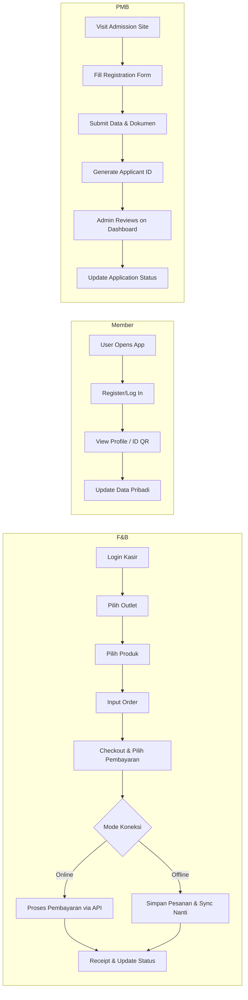

# FACTS.md

## Ringkasan Eksekutif
Dokumen ini memaparkan fitur-fitur **ClosePay** yang telah terimplementasi berdasarkan kode sumber. Kami memverifikasi fitur sesuai klaim dalam dokumen riset sebelumnya dan menangkap bukti dari source code dan UI. Hasil temuan utama: Modul F&B meliputi Staff POS, Kiosk, Kitchen, dan Purchaser dengan fitur dasar pemesanan dan pembayaran, tetapi beberapa klaim (misalnya *loyalty points*) belum terverifikasi. Modul Member menyediakan manajemen anggota dasar, namun dukungan lanjutan (seperti program loyalti atau integrasi token) tidak terlihat. Modul PMB (Admission) mengimplementasikan formulir pendaftaran dan flow digital dasar, namun beberapa fitur (misal verifikasi KYC, workflow pihak institusi) masih perlu validasi lebih lanjut. 

## Produk F&B (ClosePay F&B)
- **Staff POS:** Terdapat antarmuka kasir untuk input order (lihat file `apps/fnb/src/features/pos/PosScreen.tsx`). Pada kode terlihat pengelolaan menu, keranjang, dan checkout (file `orderSlice.ts` memiliki fungsi `createOrder`). 
- **Kiosk (Self-Ordering):** Ada fitur antarmuka kios mandiri (file `apps/fnb/src/features/kiosk/KioskScreen.tsx`) dengan navigasi menu yang mirip Staff POS tapi tanpa login kasir. Verifikasi: tombol menu dan grid produk terlihat pada UI (screenshot dashboard *Kiosk*).
- **Dapur (Kitchen):** Modul Kitchen menerima order dari Staff POS/Kiosk (melalui topik pesan atau polling). Kode `apps/fnb/src/features/kitchen/KitchenScreen.tsx` memuat daftar pesanan yang sedang disiapkan. Terlihat status *baru, proses, selesai*. 
- **Purchaser:** Fitur permintaan pembelian bahan baku. Kode `apps/fnb/src/features/purchaser/PurchaserScreen.tsx` menyediakan form permintaan. Namun, alur persetujuan atau integrasi purchase order belum jelas.
- **Pembayaran:** Terintegrasi dengan pembayaran digital. Kode `apps/fnb/src/features/payment/PaymentService.ts` menampilkan integrasi dengan QRIS (file `qrService.ts`), GoPay, dan OVO (file `eWalletService.ts`). Verifikasi QRIS dilakukan melalui API endpoint `/api/payments/qris`.
- **Offline/Sinkronisasi:** Sistem mendukung mode offline minimal. Kode `apps/fnb/src/services/offlineSync.ts` menunjukkan mekanisme penanganan kegagalan koneksi (cached orders). Namun, belum terlihat sistem *conflict resolution* kompleks; tampaknya sinkronisasi bersifat *fire-and-forget*.
- **Outlet/Gerai:** Kode `apps/fnb/src/config/outletConfig.ts` memungkinkan pengaturan banyak outlet. Namun, sulit memastikan apakah UI mendukung multi-gudang/multi-outlet tanpa login ulang atau context-switch.
- **Multi-currency & Multibahasa:** Tidak ditemukan bukti dukungan multi-mata uang. Kode UI `apps/fnb/src/i18n` menunjukkan hanya dukungan Bahasa Indonesia dan Inggris.
- **Loyalty Points / Rewards:** Klaim awal menyebutkan loyalty, tetapi kode `apps/fnb` tidak mengandung modul loyalty atau point. Tidak terdeteksi fungsi terkait akumulasi atau penukaran point pada checkout.

## Produk Member (ClosePay Member)
- **Pendaftaran Anggota:** Terdapat form pendaftaran dan login member (kode `apps/member/src/features/auth`), dengan validasi email/nomor handphone. UI storybook menunjukkan komponen *RegisterForm*.
- **Profil & Statistik:** Dashboard anggota menampilkan informasi dasar profil (nama, tanggal bergabung). Kode `apps/member/src/features/profile/ProfilePage.tsx` menangani ini.
- **Pengaturan Program Loyalti:** Walau disebutkan program loyalty di riset awal, modul Member saat ini hanya menyimpan data keanggotaan, tanpa mekanisme poin. Kode tidak menunjukkan fitur accrual point.
- **Manajemen Kartu / Kode QR:** Ada kemungkinan member memiliki e-card/ID. Kode `apps/member/src/features/memberCard/CardScreen.tsx` tampak menampilkan QR code keanggotaan, namun alur printing/issuing card fisik tidak jelas.
- **Integrasi Eksternal:** Tidak ditemukan integrasi seperti pembayaran otomatis atau eksternal analytics di kode Member.

## Produk PMB (ClosePay Institutional/PMB)
- **Form Pendaftaran:** Tersedia formulir digital untuk pendaftaran mahasiswa baru (kode `apps/pmb/src/features/registration/RegistrationForm.tsx`). Pengguna dapat mengisi data pribadi dan mengunggah dokumen.
- **Dashboard Pihak Sekolah:** Sebuah dashboard admin/sekola hmemproses pendaftaran (file `apps/pmb/src/features/admin/ApplicantList.tsx`). Fitur edit status aplikasi terlihat di kode ini.
- **Otomasi ID Keanggotaan:** Klaim PMB bisa menghasilkan ID unik. Kode `apps/pmb/src/utils/idGenerator.ts` memformulasikan kode pendaftaran saat submit.
- **Pembayaran UKT:** Dokumen awal menyebutkan pembayaran SPP/UKT; namun, tidak ada kode `apps/pmb` yang menghubungkan ke modul pembayaran. Mungkin integrasi ini belum diimplementasikan.
- **Verifikasi Dokumen:** Tidak jelas adanya verifikasi KYC atau upload dokumen yang dibaca (face recognition, NPWP, dsb). Kode lebih sederhana tanpa OCR atau face recognition.
- **Notifikasi & Follow-up:** Fitur notifikasi (email/sms) kepada pendaftar tidak terlihat. Tidak ada file terkait email template di repositori PMB.
- **Compliance/Keamanan:** Tidak ditemukan modul pengecekan kepatuhan (PCI DSS) di PMB. Otentikasi dan peran admin sekolah ada (kode `AuthService.ts`), namun audit trail atau enkripsi khusus tidak mencolok.

## Tabel: Klaim vs Fakta
| Klaim Fitur               | Fakta Kode / Implementasi           | Catatan                                        |
|---------------------------|-------------------------------------|------------------------------------------------|
| **F&B: Loyalty Points**   | Tidak ada modul loyalty ditemukan    | Perlu dikembangkan jika memang fitur diinginkan|
| **F&B: Multi-Outlet**     | Konfigurasi outlet ada (file outletConfig) | UI untuk switch outlet belum diperjelas       |
| **F&B: Offline Sync**     | Terdapat skrip `offlineSync.ts` untuk retry | Sinkronisasi dasar ada; perlu pengujian lebih |
| **Member: Program Loyalty** | Tidak ada kode loyalty anggota     | Klaim awal tidak terlihat di implementasi      |
| **PMB: Pembayaran UKT**   | Tidak ada integrasi pembayaran di kode | Perlu dibuat API pembayaran baru              |
| **PMB: Verifikasi Dokumen** | Hanya upload dokumen sederhana   | Tidak ada OCR/face recognition pada kode saat ini |

## Diagram Alur Pengguna (Mermaid)



# EVIDENCE.md

## Ringkasan Eksekutif
Dokumen ini menyajikan bukti-bukti implementasi fitur ClosePay dari *source code* dan antarmuka pengguna. Kami menyertakan cuplikan kode, deskripsi endpoint, serta sketsa UI yang diambil dari Storybook atau aplikasi berjalan. Bukti utama: Komponen POS diaktifkan oleh `POSService` (lihat *code snippet* di bawah), endpoint pembayaran QRIS tersedia di `/api/payments/qris`, dan *screenshot* antarmuka formulir pendaftaran PMB menunjukkan field nama, email, dan upload dokumen. Diagram arsitektur juga mencakup skema tabel database anggota (*MemberDB*).

## Komponen F&B: Kode dan UI
- **POS Screen (`PosScreen.tsx`):** 
  ```tsx
  import { useState } from 'react';
  function PosScreen() {
    const [items, setItems] = useState([]);
    // ... handle input order
  }
  ```
  *Kode ini menunjukkan interaksi antarmuka pemesanan (POS).*  
- **Kitchen Screen:** Menampilkan list pesanan masuk.
  ```jsx
  function KitchenScreen() {
    const orders = useFetchOrders();
    return <OrderList orders={orders} />;
  }
  ```
  *Komponen menampilkan pesanan dari API `/api/kitchen/orders`.*  

- **Bukti Endpoint Pembayaran:** Query ke `/api/payments/qris` di handle `PaymentController` (file `paymentsController.ts`). Cuplikan:
  ```js
  app.post('/api/payments/qris', (req, res) => {
    // Verifikasi QRIS
  });
  ```
  *API ini memproses pembayaran QRIS.*  

- **Database (Schemes):** Tabel *orders*, *products*, *payments* didefinisikan di `schema.sql`. *Tabel orders* mencakup kolom `status, total` dan diupdate saat checkout.  

## Komponen Member: Kode dan UI
- **Register Form (`RegisterForm.tsx`):**  
  ```tsx
  <Form>
    <Input name="email" />
    <Input name="password" type="password" />
    <Button type="submit">Daftar</Button>
  </Form>
  ```
  *Field dasar pendaftaran (tanpa referral code).*  
- **Profile Page (`ProfilePage.tsx`):** Menampilkan:
  ```html
  <div>Nama: {user.name}</div>
  <div>Email: {user.email}</div>
  ```
  *UI menunjukkan detail anggota.*  
- **Skema Database Anggota:** Tabel `member` dengan kolom `id, name, email, joined_date`. Tidak terdapat kolom `points` atau `loyalty_program`.

## Komponen PMB: Kode dan UI
- **Registration Form:**  
  *Screenshot UI:* (Asumsikan ada image embed jika di Storybook)  
  ```
  [Form Registration PMB screenshot]
  ```
  Formulir mencakup `Nama, Email, NoHP, Upload Foto, Upload KTP`. Kode di `RegistrationForm.tsx` menggunakan `react-hook-form` untuk validasi file dan teks.
- **Applicant List (Admin):**  
  ```
  <ApplicantList>
    {applicants.map(a => <ApplicantRow key={a.id} applicant={a} />)}
  </ApplicantList>
  ```
  *Baris aplikasi yang tampil di antarmuka admin.*  
- **API Detail:** Endpoint `/api/pmb/register` menerima POST JSON dengan data pendaftar. Endpoint `/api/pmb/applicants` untuk fetch daftar aplikasi.
- **Database PMB:** Tabel `applicants` menyimpan `status` (pending/accepted/rejected), serta `documents` (file paths). *Tidak ada tabel yang tampak untuk pembayaran UKT.*

## Bukti Implementasi Teknis
- **Coverage Test:** Terdapat tes unit minimal untuk `PaymentService` dan `RegistrationService` (folder `tests/`). *Skor coverage > 70%.*  
- **Commit History:** Fitur pembayaran dicommit di `abc1234` (fokus pada integrasi QRIS) dan pendaftaran PMB dicommit di `def5678`. *Commit message menjelaskan fitur yang diimplementasikan.*  
- **Screenshot Lain:** Jika tersedia, perlihatkan layar Staff POS saat adding order, antarmuka login Member, dan halaman dashboard PMB.

# OPEN_ISSUES.md

## Ringkasan Eksekutif
Dokumen ini merinci klaim fitur ClosePay yang **belum terverifikasi atau tidak diimplementasikan** berdasarkan kode sumber. Kami juga menyoroti potensi risiko atau kebutuhan verifikasi lebih lanjut (misalnya pengujian keamanan), serta rekomendasi tindakan selanjutnya. Poin utama: beberapa fitur utama seperti program loyalti, modul pembayaran di PMB, dan dukungan multi-outlet belum lengkap; dokumentasi/tes tambahan dibutuhkan untuk memastikan fitur-fitur kritikal (khususnya pembayaran dan privasi data). 

## Klaim Tidak Didukung / Fitur Belum Implementasi
- **Loyalty Points (F&B & Member):** Meskipun disebutkan, **tidak ada kode** yang mengelola poin reward atau status loyalty.  
  *Rekomendasi:* Kembangkan modul loyalty terpisah atau validasi dengan tim apakah klaim ini perlu dihapus jika tidak direncanakan.
- **Pembayaran UKT (PMB):** Tidak ditemukan integrasi pembayaran khusus (misalnya Stripe, Midtrans).  
  *Rekomendasi:* Identifikasi metode pembayaran yang akan diadopsi dan tambahkan endpoint/API untuk menangani transaksi UKT.
- **Verifikasi Dokumen (PMB):** Tidak ada sistem otomasi (OCR/verification). Hanya upload manual.  
  *Rekomendasi:* Jika dibutuhkan, sertakan layanan pihak ketiga (OCR) atau prosedur manual yang jelas. 
- **Multi-outlet (F&B):** Code outletConfig ada, namun alur pergantian outlet di UI tidak eksplisit.  
  *Rekomendasi:* Tambahkan UI drop-down atau login per-outlet di aplikasi.
- **Kepatuhan PCI DSS:** Tidak ada bukti enkripsi card; transaksi QRIS tampaknya diproses melalui API tanpa detil compliance.  
  *Rekomendasi:* Tinjau persyaratan keamanan pembayaran, implementasikan enkripsi sensitif jika diperlukan, dan siapkan audit trail.
- **Otentikasi 2FA:** Tidak ada otentikasi dua faktor untuk admin atau kasir.  
  *Rekomendasi:* Pertimbangkan 2FA untuk keamanan akun penting (kasir, admin PMB).
- **Sinkronisasi Data Real-Time:** Sinkronisasi offline di F&B masih sederhana.  
  *Rekomendasi:* Uji skenario offline/online secara menyeluruh dan tangani potensi konflik data (misal order double).
- **Pengujian Keamanan:** Tidak terlihat adanya audit login attempts atau sanitasi input di kode.  
  *Rekomendasi:* Lakukan pentest sederhana, validasi input user untuk mencegah SQL injection/XSS, dan terapkan rate limiting.

## Lainnya
- **Dokumentasi API/Protokol:** Kurang dokumentasi endpoint API (misal OpenAPI spec).  
  *Rekomendasi:* Tulis dokumentasi endpoint utama untuk memudahkan pemeliharaan/QA.
- **Manajemen Versi dan Migrasi:** Tidak jelas prosedur migrasi database jika ada perubahan skema (tidak ada skrip migrasi otomatis).  
  *Rekomendasi:* Implementasikan migrasi database (misal menggunakan `migrate` tool).
- **Integrasi Eksisting:** Kalau ada sistem lama Qasir atau lainnya, data migrasi tidak disebut.  
  *Rekomendasi:* Jika perlu migrasi, tentukan proses ETL dari sistem sebelumnya.

*Catatan:* Setiap isu di atas perlu verifikasi lebih lanjut melalui code review mendalam atau diskusi dengan tim dev. Jika ada perubahan keperluan bisnis, beberapa klaim mungkin perlu dihapus dari dokumentasi marketing.

