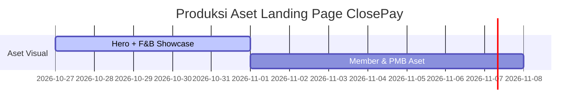

# 01_PRODUCT_BRAND_INTELLIGENCE.md

## Ringkasan Eksekutif  
ClosePay adalah platform digital all-in-one untuk segmen F&B, keanggotaan, dan layanan institusional (PMB). Untuk pengguna F&B, ClosePay mencakup *POS (kasir staf)*, *Kiosk pelanggan*, *KDS (dapur)*, dan *Purchaser (pengadaan)*. Untuk *Member*, tersedia aplikasi konfigurasi keanggotaan dan loyalty. Untuk *Institusi/PMB*, platform menyediakan alur pendaftaran dan informasi digital. Tujuan halaman landing adalah memperkenalkan setiap produk nyata ClosePay, menunjukkan bagaimana produk tersebut bekerja, dan mendorong pengunjung untuk mencoba demo atau menghubungi sales. Dokumen ini merangkum fitur utama, persona pengguna, alur kerja, serta strategi konten dan konversi yang disarankan untuk mendukung pengalaman landing page berkualitas tinggi dan berfokus produk.

## Portofolio Produk ClosePay  
- **F&B Suite** – Menyasar restoran/kafe/warung. Terdiri dari:  
  - *Staff POS*: Aplikasi kasir di tablet/HP (Android/iOS) yang mencatat pesanan & transaksi secara otomatis. Dilengkapi pengelolaan menu, diskon, dan laporan harian real-time. Bisa bekerja offline dan sinkron saat online.  
  - *Kiosk Pelanggan*: Terminal self-order untuk pelanggan memesan makanan/minuman sendiri; terintegrasi langsung ke sistem POS dan dapur.  
  - *Kitchen Display (KDS)*: Layar digital di dapur yang menampilkan pesanan masuk, memastikan pesanan dikelola secara terstruktur.  
  - *Purchaser/Supplier*: Modul untuk pengelolaan pembelian bahan baku dan vendor, mempermudah pengadaan stok barang dapur secara efisien.  
- **Member** – Aplikasi manajemen keanggotaan bisnis (retail atau klub pelanggan). Mencakup pendaftaran anggota, pengaturan tingkatan/poin loyalitas, serta pemindaian atau kode QR untuk verifikasi anggota. Memungkinkan bisnis mengelola data anggota dan program loyalitas langsung dari dashboard.  
- **Institusi/PMB** – Portal digital untuk institusi pendidikan: memungkinkan calon mahasiswa melakukan pendaftaran online (formulir digital), serta panel informasi bagi pengurus untuk memproses registrasi dan mengumumkan hasil. Menyederhanakan alur penerimaan mahasiswa baru secara elektronik.

## Persona Pengguna & Tujuan Utama  
- **Pemilik Bisnis F&B**: Pemilik restoran atau kafe yang membutuhkan solusi cepat untuk mengefisienkan operasional. *Jobs-to-be-done*: Memantau penjualan harian, mengelola inventaris, mengurangi kebocoran pencatatan kas, dan meningkatkan kepuasan pelanggan.  
- **Kasir/Staff Pelayanan**: Staf yang bertugas mengambil pesanan, memasukkan ke sistem, dan menerima pembayaran. *Goals*: Memproses pesanan dengan cepat, menghindari kesalahan input, dan mudah menggunakan sistem kasir.  
- **Pelanggan F&B**: Pengguna Kiosk atau pelanggan restoran. *Goals*: Memesan & membayar makanan/minuman secara mandiri dengan antarmuka yang jelas dan proses yang lancar.  
- **Manajer/Karyawan Inventori**: Pengelola stok bahan baku (Purchaser). *Goals*: Melacak persediaan, mengajukan pesanan barang dengan mudah, dan melihat status pembelian.  
- **Manajer Pemasaran/Customer Loyalty**: Admin sistem *Member*. *Jobs*: Menciptakan promo loyalitas, mengelola data anggota, dan mendorong keterlibatan pelanggan melalui reward.  
- **Mahasiswa Calon Siswa**: Individu yang melakukan pendaftaran via layanan PMB. *Goals*: Mengisi formulir secara online dengan antarmuka mudah dan menerima notifikasi hasil pendaftaran.  
- **Staff Administratif Pendidikan**: Pengelola PMB di institusi. *Goals*: Mengelola alur penerimaan (verifikasi data, pengumuman hasil) secara digital dan terintegrasi dengan sistem kampus.  

## Alur Pengguna & Titik Sentuh UI  
- **F&B**: Mulai dari *POS Staf*: kasir memasukkan pesanan dengan antarmuka menu/menu, memilih metode pembayaran (tunai, QRIS, e-wallet). Order tersebut secara real-time muncul di *KDS* untuk proses dapur. Transaksi tercatat otomatis (laporan finansial). Jika pelanggan menggunakan *Kiosk*, ia memilih menu sendiri dan membayar – hasilnya langsung muncul di sistem kasir dan dapur.  
- **Member**: Pengguna mengunduh/mendaftarkan akun membership via link atau kode toko. Admin menyiapkan keanggotaan (misalnya level loyalitas). Setiap transaksi, anggota dipindai via kode QR atau kartu; poin loyalitas dan diskon terintegrasi dalam proses checkout. UI penting: layar keanggotaan, pengaturan promo, riwayat poin.  
- **Institusi/PMB**: Calon mendaftar via form online (UI formulir responsif); setelah submit, sistem mengirim notifikasi dan pengumuman diterima via dasbor admin. UI penting: dashboard pendaftaran, formulir interaktif, dan notifikasi status.  

Titik sentuh UI yang disorot pada landing page: antarmuka *POS Staf* (tampilan kasir dengan ringkasan transaksi), *Kiosk* (UI layar sentuh pesanan), layar *KDS* (monitor order dapur), layar *Aplikasi Member* (profil anggota & poin), dan portal *Institusi* (simulasi halaman pendaftaran digital). Asset visual sebaiknya merepresentasikan produk riil (bukan ilustrasi abstrak).

## Fitur Utama & Nilai Produk  
- **Omnichannel F&B**: Order masuk dari staf kasir maupun kiosk terintegrasi dalam satu sistem. Multi-outlet sync (untuk bisnis waralaba/rantai).  
- **Pembayaran Modern**: Terima semua metode pembayaran digital (QRIS, e-wallet, kartu). *Trust signal*: integrasi QRIS tercatat otomatis, bukti keamanan dan kemudahan transaksi.  
- **Laporan & Analitik**: Dasbor real-time (penjualan harian, keuntungan, pengeluaran). Otomatisasi akuntansi dan rekap email setiap hari. *Nilai*: pemilik selalu tahu perbandingan pemasukan vs biaya.  
- **Manajemen Inventori**: Stok tersinkronisasi otomatis dari setiap penjualan. Pengingat order bahan saat stok menipis. Fitur pembelian (purchase order) terintegrasi supplier.  
- **Kustomisasi UI & Program**: Bisnis dapat menyesuaikan menu, harga, dan program loyalitas sesuai kebutuhan. Mode multi-currency atau multi-bahasa (Indonesia utama).  
- **Keamanan & Kepatuhan**: Data transaksi dienkripsi, patuhi standar keuangan (PCI DSS) dan regulasi lokal. Integrasi dengan sistem ERP atau POS lama via API jika diperlukan.  
- **Scalability**: Cocok untuk UKM hingga enterprise kecil (dapat berkembang dari satu outlet ke multi-outlet dengan fitur manajemen karyawan dan hak akses).  

## Sinyal Kepercayaan & Batasan  
- **Portofolio Client/Case Studies**: Tampilkan logo usaha/perusahaan (misalnya restoran ternama), studi kasus sukses untuk membangun kepercayaan.  
- **Certifications/Partnerships**: Misalnya sertifikasi keamanan, kerja sama bank/payment gateway.  
- **Trial & Garansi**: Opsi *coba gratis 7/14 hari*, dukungan demo – strategi umum di kompetitor (Qasir memiliki “Coba Gratis” dan “Jadwalkan Demo”).  
- **Batasan/Terms**: Informasi jelas mengenai biaya bulanan/lisensi, biaya transaksi QRIS (seperti Qasir: 0,7% di atas Rp100.000), dan kebijakan keamanan data.  
- **Customer Support**: Jaminan layanan pelanggan (chat, telepon, tutorial).  

## Pesaing Utama  
Berikut contoh pesaing sejenis (khususnya untuk segmen F&B POS) dan fitur utamanya:  

| Pesaing            | Fokus Segmen            | Keunggulan Utama                                              |
|--------------------|-------------------------|---------------------------------------------------------------|
| **Qasir**          | POS & digital ordering F&B (Indonesia) | Aplikasi POS berbasis Android untuk UKM; gratis awal, integrasi pembayaran (QRIS tercatat otomatis), dukung offline dan printer nota. |
| **Pawoon**         | POS F&B (Indonesia)     | Antarmuka simpel untuk kasir, bundling hardware (tablet+printer), fitur loyalty sederhana, dukung offline dan laporan terperinci. |
| **Moka (Stripe)**  | POS omnichannel F&B (Indonesia) | Cloud POS + backoffice; realtime analytics, manajemen multi-outlet, integrasi GoFood/GoPay, klaim bisnis 70% lebih sehat dengan Moka. |
| **Toast**         | POS restoran (Amerika)  | Sistem POS & pembayaran komprehensif; manajemen meja/meja digital, loyalti & gift cards, fokus restoran cepat saji dan casual dining. |
| **Majoo**          | POS & ERP (Indonesia)   | Aplikasi kasir + akuntansi + CRM dalam satu platform; paket “Prime” khusus F&B, trial 14 hari gratis. |

*Catatan:* Daftar di atas hanya contoh; kualitas desain landing page ditentukan oleh cara penyampaian produk, bukan jumlah pesaing. Fokus landing page ClosePay adalah menonjolkan nilai unik (misalnya modul seluruh-satu, fleksibilitas tinggi) dibandingkan fitur spesifik pesaing.

## Tujuan Konversi & Konten  
- **Konversi Utama:** Mendorong pengunjung melakukan *demo request* atau *trial sign-up* (misalnya tombol “Coba Gratis”, “Jadwalkan Demo”). CTA sekunder: “Hubungi Kami” (untuk permintaan khusus atau integrasi).  
- **Konten Tone:** Bahasa Indonesia natural, ramah tetapi profesional. Hindari jargon teknis berlebihan; fokus pada manfaat konkret (cepat, aman, terukur). Gunakan contoh konkret (“Lihat laporan harian, tidak perlu hitung manual”), testimoni singkat, dan data pendukung (misal “berhasil tingkatkan efisiensi” dengan grafik sederhana). Hindari klaim hiperbolik tanpa bukti.  
- **Struktur Narasi:** Mulai dengan masalah umum (kasir lambat, manajemen manual, pendaftaran kuliah ribet), lalu kenalkan ClosePay sebagai solusi terpadu. Gunakan storytelling (mis. kisah pemilik warung atau calon mahasiswa) untuk konteks.  

**Prioritas konten halaman (rekomendasi):**  
- **Hero (Halaman Awal):** Judul jelas (misal *“ClosePay – Solusi Digital All-in-One untuk Bisnis F&B & Keanggotaan”*). Highlight ringkas: manfaat utama (otomatisasi kasir & loyalty). Visual: ilustrasi produk di layar (contoh mockup UI POS atau Kiosk). CTA utama: “Coba Gratis” atau “Demo Sekarang”.  
- **Tampilkan Produk Inti:** Segera setelah hero, perkenalkan setiap produk dengan tajuk berbeda. Misal, section “Pos Staf & Kiosk” (dengan screenshot UI), “Program Member” (contoh UI daftar member), “PMB Digital” (contoh formulir pendaftaran online). Sertakan poin-poin nilai di setiap bagian (bullet/ikon).  
- **Use Cases/Keunggulan:** Buat section kasus penggunaan: “Bagaimana ClosePay Meningkatkan Bisnis Anda” dengan ilustrasi mini-story (misalnya restoran cepat saji, kafe, club pelanggan, kampus). Tekankan hasil spesifik (mengurangi waktu antre, meningkatkan retensi pelanggan, memudahkan pendaftaran siswa).  
- **Aksi (CTA) di Tiap Bagian:** Setiap section produk atau use case mengarah ke tindakan: *“Pelajari Fitur”, “Mulai Trial Gratis”*, atau *“Hubungi Kami untuk Demo”*.  
- **Kepercayaan:** Seksi testimonial singkat (kutipan pengguna nyata) atau logo klien, sertakan bullet highlight compliance/integrasi (mis. “Terintegrasi QRIS/E-Wallet”, “Data terenkripsi SSL”).  
- **Footer:** Info kontak, media sosial, dan tombol CTA ulang (formulir kontak atau demo).

## Rekomendasi Pelaksanaan  
- Mulai dengan **pembuatan aset hero & demo F&B** terlebih dahulu: desain hero image yang menampilkan layar ClosePay (contoh UI POS atau Kiosk) bersama judul berdampak. Serentak, buat showcase satu kasus F&B (misalnya alur kasir dan dapur) untuk diteguhkan visualnya. Setelah hasil hero & showcase F&B dirasa tepat, lanjutkan pembuatan asset lainnya (member app, PMB portal, dsb).  
- **Timeline** pengerjaan aset (contoh):  

Dokumen ini berorientasi praktis: fokus menampilkan produk nyata ClosePay, mempertegas nilai unik, dan menyiapkan konten/konten pendukung yang memicu konversi (demo/trial). Setiap konten disarankan diuji coba (review desain) demi memastikan arah kreatif yang kohesif, menarik, dan benar-benar *product-first*.  

**Sumber:** Informasi produk dari riset internal ClosePay (jika ada), ditambah studi situs pesaing (misalnya Qasir, Moka) untuk memahami positioning pasar dan praktik umum fitur.